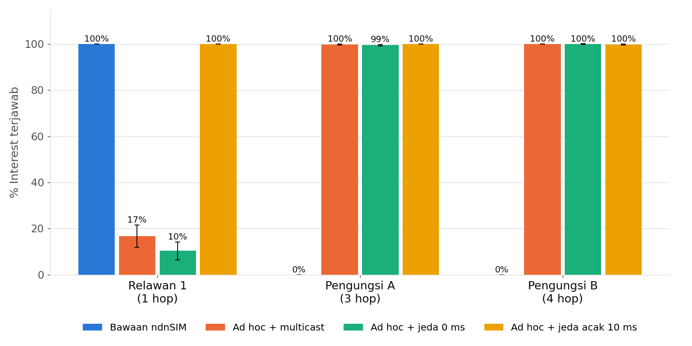

# NDN pada WiFi Ad Hoc untuk Komunikasi Darurat Pascabencana

**Named Data Networking pada Jaringan WiFi Ad Hoc untuk Komunikasi Darurat Pascabencana: Evaluasi dan Perbaikan
Strategi Forwarding Berbasis Simulasi ndnSIM** — tugas Mata Kuliah Named Data Networking, Kelompok 3,
Teknik Telekomunikasi ITB: Raqinnaja Axsali (18123054), Daffa Naufal (18123023), Ridho Radifa Al-Haq (18123010).



## Temuan utama (690 simulasi ndnSIM, 10 seed per konfigurasi)

1. **Bawaan ndnSIM tidak bisa multi-hop di WiFi**: face WiFi-nya *point-to-point*, pengungsi 3–4 hop mendapat 0%.
   Face `AD_HOC` memperbaikinya.
2. **Node terdekat posko lalu gagal (±17%)** karena **transmisi serempak**: posko dan relay dipicu frame yang
   sama dan memancar bersamaan. Uji kontrol membantah dugaan awal *hidden terminal*.
3. **Strategi usulan `jitter-broadcast`** (jeda acak sebelum meneruskan Interest + izin meneruskan Interest
   ulang): semua node ≈100%, waktu tunggu rata-rata 286 → 68 ms dibanding versi minggu 1, frame per Data 30% lebih
   hemat daripada multicast; bertahan sampai 9 hop, pada topologi acak 20 node (multicast hanya 32%), dan saat
   node bergerak.
4. **Data bersama**: agregasi PIT dan *cache* NDN memotong frame per Data 51–65%.

Angka lengkap: [eksperimen/HASIL.md](eksperimen/HASIL.md).

## Isi repo

| Lokasi | Isi |
|---|---|
| [AGENTS.md](AGENTS.md) | Konteks dan aturan untuk agen AI / anggota tim (**baca dulu**) |
| [docs/PENELITIAN.md](docs/PENELITIAN.md) | Rumusan masalah, hipotesis, metodologi, batasan |
| [docs/LITERATUR.md](docs/LITERATUR.md) | Tinjauan pustaka dan 23 rujukan terverifikasi (IEEE) |
| [docs/PANDUAN-ARTIKEL-DAN-SLIDE.md](docs/PANDUAN-ARTIKEL-DAN-SLIDE.md) | Pesan inti, glosarium, struktur artikel dan slide, koreksi |
| [eksperimen/](eksperimen/) | Skenario ndnSIM, skrip, data mentah, ringkasan, grafik ([README](eksperimen/README.md), [HASIL](eksperimen/HASIL.md)) |
| [praktik/](praktik/) | Laporan praktik instalasi ndnSIM kelompok |

## Menjalankan ulang

Butuh ndnSIM 2.9 di Ubuntu 20.04 (native/WSL) dan Python 3 + matplotlib:

```bash
cd eksperimen
bash jalankan.sh      # 690 simulasi, ±20 menit
python3 analisis.py   # tabel dan grafik
```
